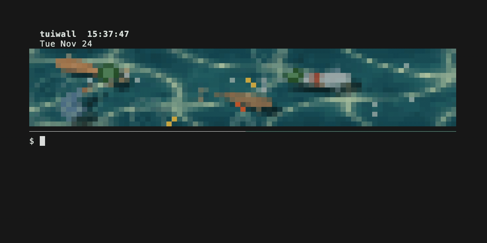
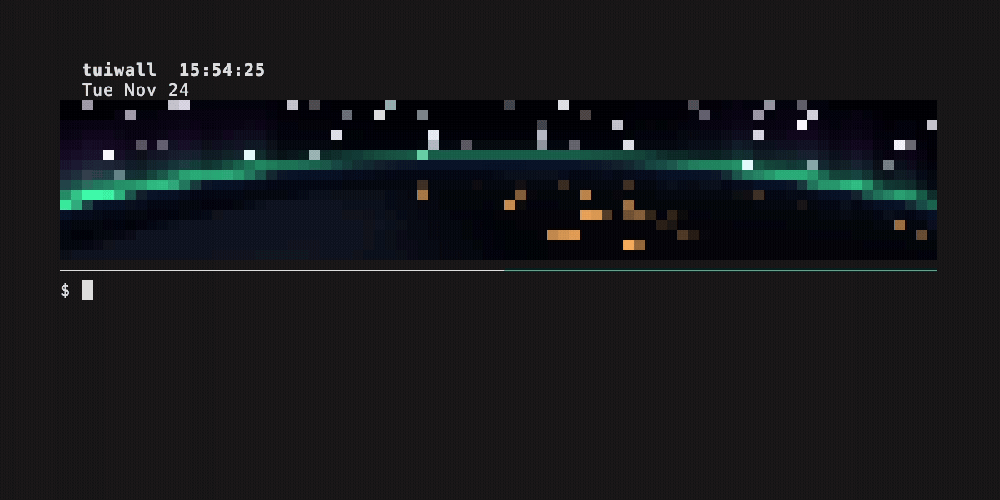
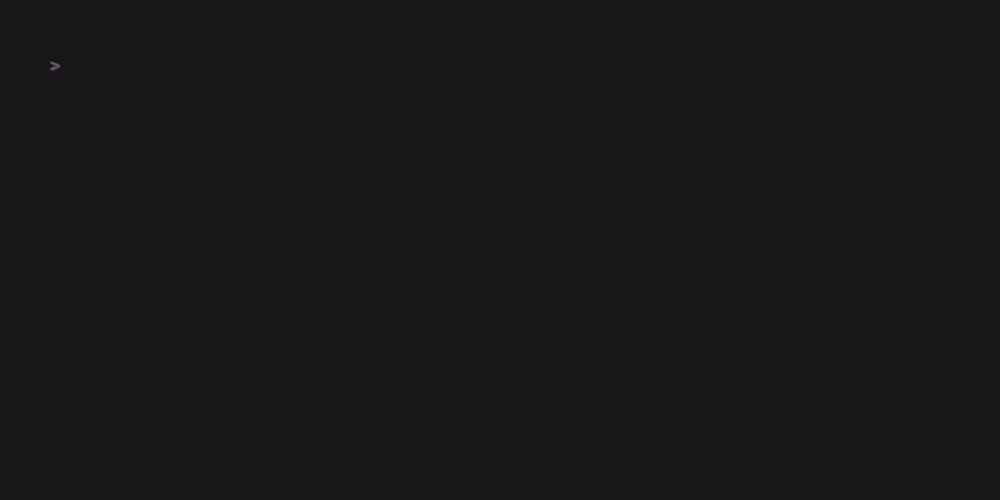
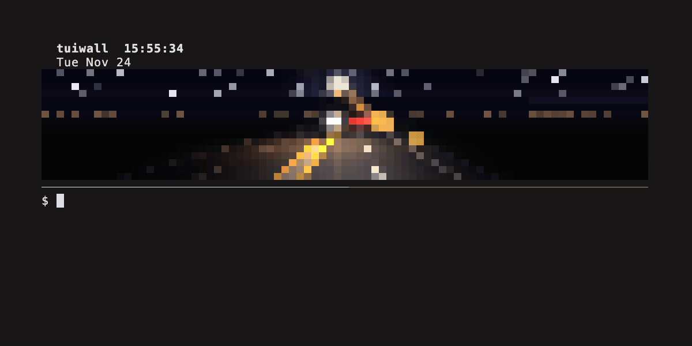
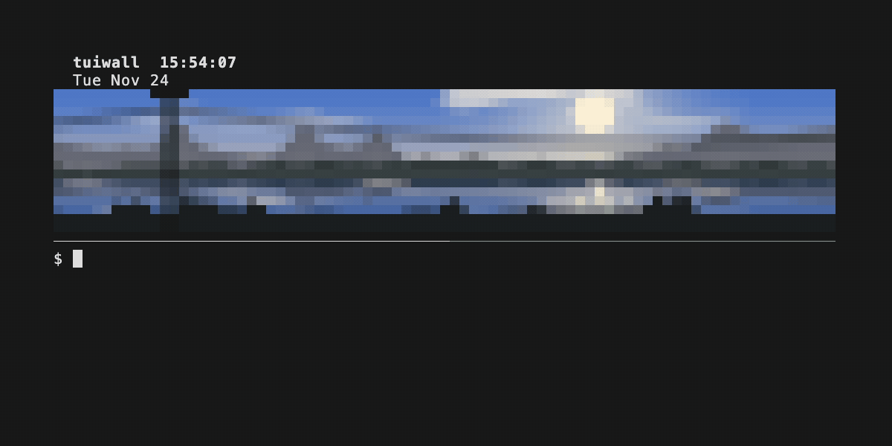
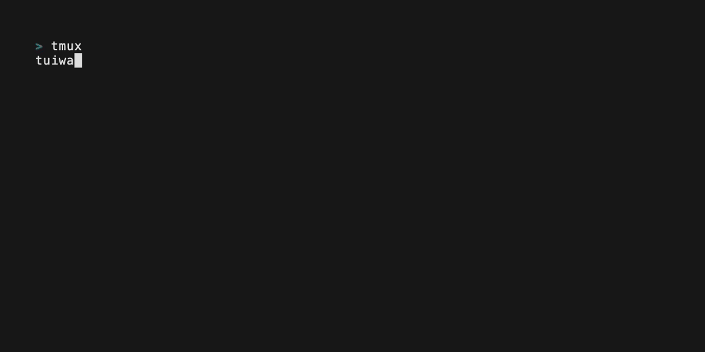
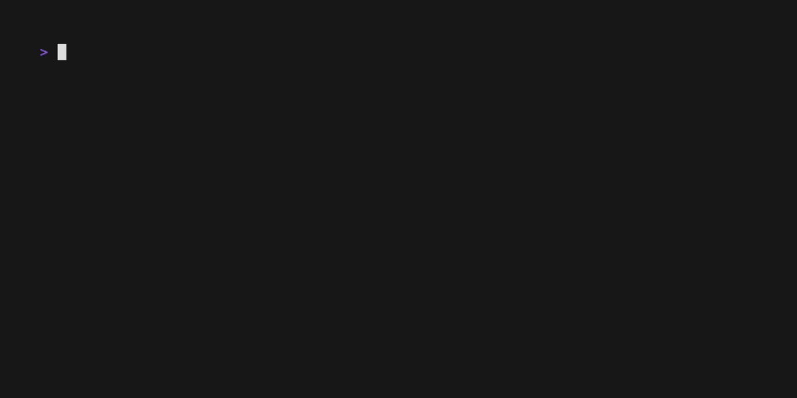
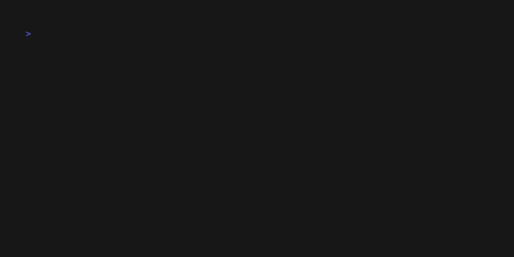
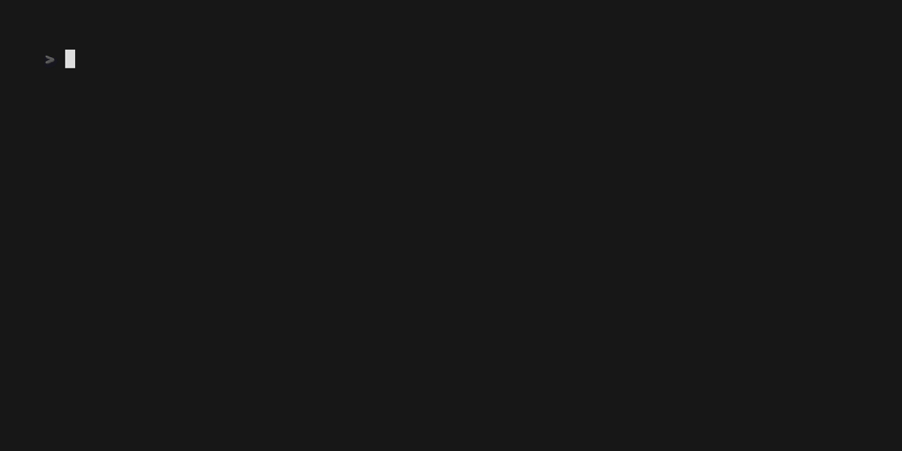

# TUIWALL PRESETS

## Table of Contents
* [Ambiance](#ambiance)
* [Animation](#animation)
* [Dashboard](#dashboard)
* [Misc](#misc)
* [System](#system)

---

### Ambiance
<details><summary>Click to view category</summary>

<details><summary><b>Bubbles</b> - Rising colorful bubbles (No Preview)</summary>

**Install:**
```bash
tuiwall install bubbles
```

[View Source](https://github.com/Mug-Costanza/tuiwall-presets/tree/main/presets/bubbles)

</details>

<details><summary><b>Koi Pond</b> - Koi gliding under lily pads; light, weather and season follow your clock</summary>

**Install:**
```bash
tuiwall install koipond
```

| <a href='https://github.com/Mug-Costanza/tuiwall-presets/tree/main/presets/koipond'></a> |
| :--- |
| [View Source](https://github.com/Mug-Costanza/tuiwall-presets/tree/main/presets/koipond) |

</details>

<details><summary><b>Low Orbit</b> - The view from a space station: sunrises, city lights, lightning and aurora</summary>

**Install:**
```bash
tuiwall install orbit
```

| <a href='https://github.com/Mug-Costanza/tuiwall-presets/tree/main/presets/orbit'></a> |
| :--- |
| [View Source](https://github.com/Mug-Costanza/tuiwall-presets/tree/main/presets/orbit) |

</details>

<details><summary><b>Matrix</b> - Digital matrix rain</summary>

**Install:**
```bash
tuiwall install matrix
```

| <a href='https://github.com/Mug-Costanza/tuiwall-presets/tree/main/presets/matrix'></a> |
| :--- |
| [View Source](https://github.com/Mug-Costanza/tuiwall-presets/tree/main/presets/matrix) |

</details>

<details><summary><b>Night Drive</b> - Cruising down the highway; the sky and the traffic follow your local time</summary>

**Install:**
```bash
tuiwall install nightdrive
```

| <a href='https://github.com/Mug-Costanza/tuiwall-presets/tree/main/presets/nightdrive'></a> |
| :--- |
| [View Source](https://github.com/Mug-Costanza/tuiwall-presets/tree/main/presets/nightdrive) |

</details>

<details><summary><b>Ocean</b> - Ocean waves</summary>

**Install:**
```bash
tuiwall install ocean
```

| <a href='https://github.com/Mug-Costanza/tuiwall-presets/tree/main/presets/ocean'></a> |
| :--- |
| [View Source](https://github.com/Mug-Costanza/tuiwall-presets/tree/main/presets/ocean) |

</details>

<details><summary><b>Rain</b> - Rainfall with wind</summary>

**Install:**
```bash
tuiwall install rain
```

| <a href='https://github.com/Mug-Costanza/tuiwall-presets/tree/main/presets/rain'></a> |
| :--- |
| [View Source](https://github.com/Mug-Costanza/tuiwall-presets/tree/main/presets/rain) |

</details>

<details><summary><b>Snowfall</b> - Falling snow</summary>

**Install:**
```bash
tuiwall install snowfall
```

| <a href='https://github.com/Mug-Costanza/tuiwall-presets/tree/main/presets/snowfall'></a> |
| :--- |
| [View Source](https://github.com/Mug-Costanza/tuiwall-presets/tree/main/presets/snowfall) |

</details>

<details><summary><b>Window Seat</b> - Lo-fi train ride along a lake, under a sky that follows your local time</summary>

**Install:**
```bash
tuiwall install windowseat
```

| <a href='https://github.com/Mug-Costanza/tuiwall-presets/tree/main/presets/windowseat'></a> |
| :--- |
| [View Source](https://github.com/Mug-Costanza/tuiwall-presets/tree/main/presets/windowseat) |

</details>


</details>

### Animation
<details><summary>Click to view category</summary>

<details><summary><b>Donut</b> - Spinning ASCII donut</summary>

**Install:**
```bash
tuiwall install donut
```

| <a href='https://github.com/Mug-Costanza/tuiwall-presets/tree/main/presets/donut'></a> |
| :--- |
| [View Source](https://github.com/Mug-Costanza/tuiwall-presets/tree/main/presets/donut) |

</details>


</details>

### Dashboard
<details><summary>Click to view category</summary>

<details><summary><b>Clock</b> - Digital clock</summary>

**Install:**
```bash
tuiwall install clock
```

| <a href='https://github.com/Mug-Costanza/tuiwall-presets/tree/main/presets/clock'></a> |
| :--- |
| [View Source](https://github.com/Mug-Costanza/tuiwall-presets/tree/main/presets/clock) |

</details>


</details>

### Misc
<details><summary>Click to view category</summary>

<details><summary><b>DVD</b> - Bouncing DVD text</summary>

**Install:**
```bash
tuiwall install dvd
```

| <a href='https://github.com/Mug-Costanza/tuiwall-presets/tree/main/presets/dvd'></a> |
| :--- |
| [View Source](https://github.com/Mug-Costanza/tuiwall-presets/tree/main/presets/dvd) |

</details>

<details><summary><b>Template</b> - Template (No Preview)</summary>

**Install:**
```bash
tuiwall install template
```

[View Source](https://github.com/Mug-Costanza/tuiwall-presets/tree/main/presets/template)

</details>

<details><summary><b>Tetris</b> - Falling tetrominos</summary>

**Install:**
```bash
tuiwall install tetris
```

| <a href='https://github.com/Mug-Costanza/tuiwall-presets/tree/main/presets/tetris'></a> |
| :--- |
| [View Source](https://github.com/Mug-Costanza/tuiwall-presets/tree/main/presets/tetris) |

</details>


</details>

### System
<details><summary>Click to view category</summary>

<details><summary><b>Stats</b> - Displays CPU, RAM, and Disk usage</summary>

**Install:**
```bash
tuiwall install stats
```

| <a href='https://github.com/Mug-Costanza/tuiwall-presets/tree/main/presets/stats'></a> |
| :--- |
| [View Source](https://github.com/Mug-Costanza/tuiwall-presets/tree/main/presets/stats) |

</details>


</details>

# End of List

